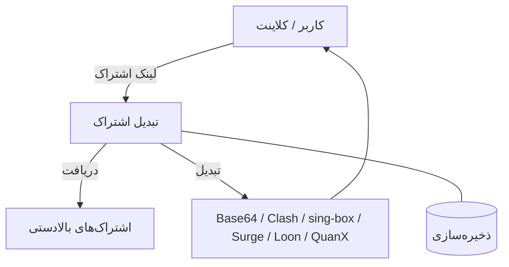
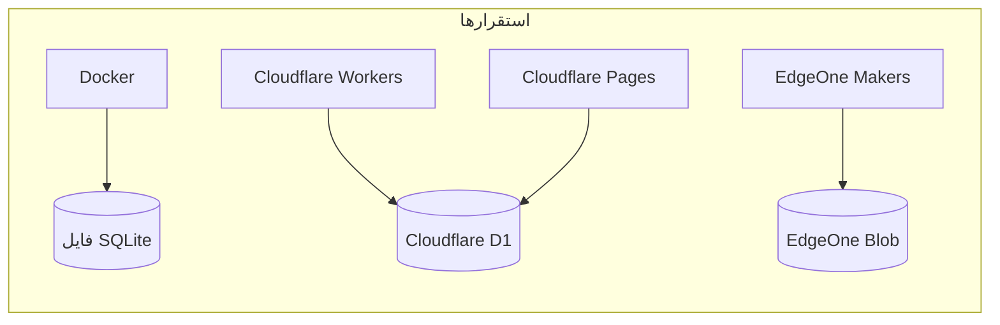
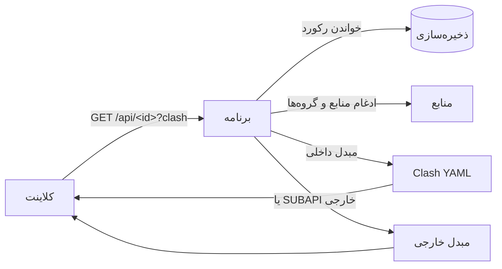

<div dir="rtl">

# subconverter-with-web

تبدیل اشتراک — بازنویسی subconverter با TypeScript و Hono. لینک‌های اشتراک پروکسی را به شش قالب Base64، Clash، sing-box، Surge، Loon و Quantumult X تبدیل می‌کند، با پنل مدیریت وب.

[English](README.md) · [中文](README.zh-CN.md)

---

## معماری



یک کد، چهار استقرار، یک رابط ذخیره‌سازی (`Store`):



| استقرار | ذخیره‌سازی | نقطه ورود |
|---|---|---|
| Docker | فایل SQLite (`/app/data/app.db`) | `src/node.ts` |
| Cloudflare Workers | D1 (`subconverter`) | `src/index.ts` (`wrangler.toml`) |
| Cloudflare Pages | D1 (`subconverter`) | `pages/functions/[[path]].ts` |
| EdgeOne Makers | Blob (`subconverter`) | `cloud-functions/[[default]].ts` |

> جدول ذخیره‌سازی در اولین دسترسی ساخته می‌شود (`CREATE TABLE IF NOT EXISTS kv`). در EdgeOne، Blob انقضا ندارد، پس زمان انقضا داخل هر مقدار ذخیره می‌شود.

---

## ویژگی‌ها

- **همه پروتکل‌ها** — VLESS، VMess، Trojan، Shadowsocks، Hysteria2، TUIC، AnyTLS و بیشتر.
- **شش قالب خروجی** — Base64، Clash، sing-box، Surge، Loon، Quantumult X.
- **پنل مدیریت** — ساخت، ویرایش و حذف لینک‌های اشتراک، گروه‌ها، بک‌اندهای SUBAPI و قالب‌های SUBCONFIG.
- **دو نوع لینک**

  | | لینک مهمان | لینک شخصی |
  |---|---|---|
  | مسیر | `/api/<id>` | `/<id>` |
  | قابل ویرایش | خیر — حذف و ساخت دوباره | بله |
  | مدیر چه می‌بیند | فقط نام | همه جزئیات |

- **گروه‌ها** — چند منبع را در یک گروه جمع کنید؛ یک اشتراک می‌تواند از گروه، منابع مستقیم یا هر دو استفاده کند.
- **انقضای لینک** — تاریخ و ساعت انقضا تعیین کنید؛ لینک‌های منقضی به‌صورت خودکار حذف می‌شوند.
- **دکمه‌های ایمپورت** — ایمپورت با یک ضربه در ۱۲ کلاینت: sing-box، Shadowrocket، v2rayNG، FlClash، Clash Meta، Clash، Quantumult X، Surge، Loon، Hiddify، Stash، Karing. دکمه‌ها بر اساس دستگاه بازدیدکننده فیلتر می‌شوند.
- **سه زبان** — 中文، English، فارسی (راست‌به‌چپ). اولین بازدید از زبان سیستم پیروی می‌کند.
- **پشتیبان و بازیابی** — خروجی/ورودی همه داده‌ها به‌صورت JSON؛ بازنشانی کارخانه همه چیز را پاک می‌کند.

---

## یک اشتراک چگونه سرو می‌شود



نام فایل از نام اشتراک پیروی می‌کند (`<نام>.yaml`، `<نام>.json`، `<نام>.conf`، `<نام>.txt`). اشتراک‌های بدون نام به‌صورت پیش‌فرض `sub-yyyy-mm-dd-HHMM` (به وقت تایپه) نام می‌گیرند.

---

## استقرار

### Docker

```sh
docker run -d --name subconverter-web \
  -p 127.0.0.1:3000:3000 \
  -v /opt/subconverter-with-web/data:/app/data \
  --restart unless-stopped \
  hooleeas/subconverter-with-web:latest
```

یا با Compose:

```yaml
services:
  subconverter-web:
    image: hooleeas/subconverter-with-web:latest
    ports:
      - "127.0.0.1:3000:3000"
    volumes:
      - ./data:/app/data
    restart: unless-stopped
```

پلتفرم‌های ایمیج: `linux/amd64`، `linux/arm64`، `linux/arm/v7`.

### Cloudflare Workers

```sh
# 1. ساخت پایگاه D1
npx wrangler d1 create subconverter

# 2. شناسه برگشتی را در wrangler.toml بگذارید
#    (جای REPLACE_WITH_D1_DATABASE_ID)

# 3. استقرار
npm run deploy:worker
```

### Cloudflare Pages

```sh
# 1. ساخت پایگاه D1 (مانند بالا)
npx wrangler d1 create subconverter

# 2. شناسه برگشتی را در pages/wrangler.jsonc بگذارید
#    (جای REPLACE_WITH_D1_DATABASE_ID)

# 3. استقرار
npm run deploy:pages
```

### EdgeOne Makers

```sh
# 1. نصب CLI (فقط یک بار)
npm i -g @edgeone/cli

# 2. استقرار از ریشه پروژه
edgeone makers deploy
```

ذخیره‌سازی Blob نیازی به پیکربندی ندارد — مخزن `subconverter` در اولین نوشتن ساخته می‌شود.

---

## استفاده

1. صفحه اصلی را باز کنید، یک SUBAPI و یک SUBCONFIG انتخاب کنید، یک یا چند لینک اشتراک (یا لینک نود) بچسبانید و روی **ساخت** بزنید.
2. لینک را کپی کنید یا روی دکمه ایمپورت بزنید تا مستقیم در کلاینت باز شود.
3. `/admin` را باز کنید تا لینک‌ها، گروه‌ها، بک‌اندها، قالب‌های قوانین و تنظیمات سایت را مدیریت کنید.

ورود مدیر اختیاری است: اگر حسابی تنظیم نشده باشد، پنل باز است. در **تنظیمات سایت** حساب بسازید تا قفل شود.

---

## API (خلاصه)

| متد و مسیر | کار |
|---|---|
| `GET /api/health` | بررسی سلامت ← `{"ok":true}` |
| `GET /version` | `subconverter-with-web v0.1.0` |
| `POST /api/subscribe` | ساخت لینک مهمان |
| `GET /api/:id` | سرو لینک مهمان (`?clash`، `?sb`، `?surge`، `?quanx`، `?loon`، `?b64`) |
| `GET /:id` | سرو لینک شخصی (همان پارامترها) |
| `POST /api/convert` | تبدیل لینک‌ها/نودهای ارسالی به یک قالب |
| `GET /sub?target=<قالب>&url=<اشتراک>` | نقطه پایانی سازگار با subconverter قدیمی |
| `GET /api/public/options` | بک‌اندها، قالب‌های قوانین، عنوان سایت، آیکون |
| `GET /api/admin/*` | مدیریت: لینک‌ها، گروه‌ها، پیکربندی، خروجی/ورودی داده |

---

## توسعه

```sh
npm ci
npm run build   # tsc
npm run dev     # سرور محلی روی :3000 (SQLite)
npx wrangler dev --port 3102   # Workers با D1 محلی
```

## مجوز

MIT

</div>
