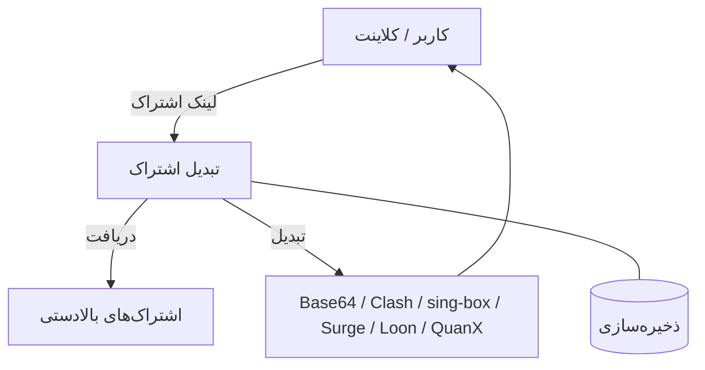
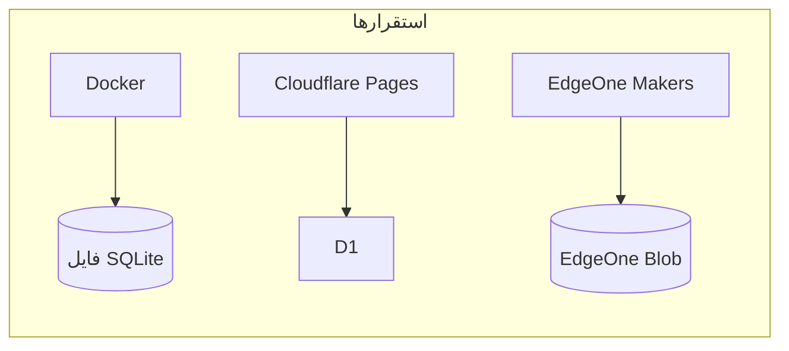
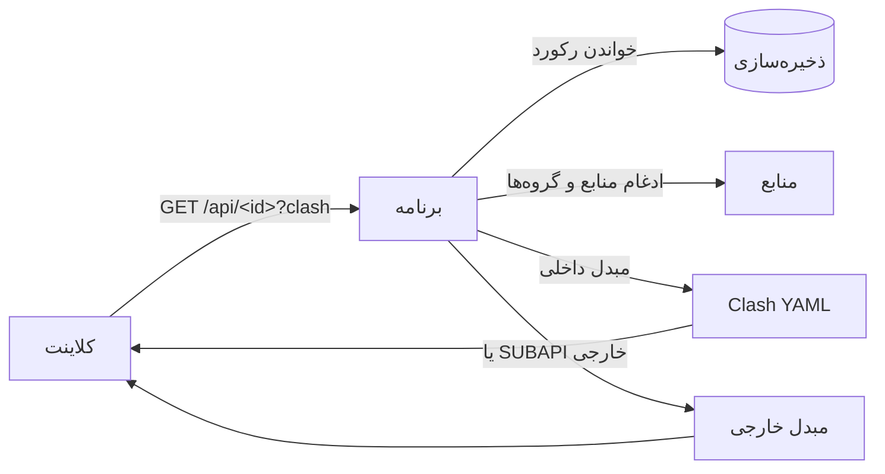

<div dir="rtl">

# subconverter-with-web

تبدیل اشتراک — بازنویسی [hooleeas/subconverter-new](https://github.com/hooleeas/subconverter-new) با TypeScript و Hono. لینک‌های اشتراک پروکسی را به شش قالب Base64، Clash، sing-box، Surge، Loon و Quantumult X تبدیل می‌کند، با پنل مدیریت وب.

[English](README.md) · [中文](README.zh-CN.md)

---

## معماری



یک کد، سه استقرار، یک رابط ذخیره‌سازی (`Store`):



| استقرار | ذخیره‌سازی | نقطه ورود |
|---|---|---|
| Docker | فایل SQLite (`/app/data/app.db`) | `src/node.ts` |
| Cloudflare Pages | D1 (`subconverter`) | `pages/functions/[[path]].ts` |
| EdgeOne Makers | Blob (`subconverter`) | `cloud-functions/[[default]].ts` |

> جدول ذخیره‌سازی در اولین دسترسی ساخته می‌شود (`CREATE TABLE IF NOT EXISTS kv`). در EdgeOne، Blob انقضا ندارد، پس زمان انقضا داخل هر مقدار ذخیره می‌شود.

---

## ویژگی‌ها

- **همه پروتکل‌ها** — VLESS، VMess، Trojan، Shadowsocks، Hysteria2، TUIC، AnyTLS و بیشتر.
- **شش قالب خروجی** — Base64، Clash، sing-box، Surge، Loon، Quantumult X.
- **پنل مدیریت** — ساخت، ویرایش و حذف لینک‌های اشتراک، گروه‌ها، بک‌اندهای SUBAPI و قالب‌های SUBCONFIG.
- **دو نوع لینک**

  | | لینک مهمان | لینک شخصی |
  |---|---|---|
  | مسیر | `/api/<id>` | `/<id>` |
  | قابل ویرایش | خیر — حذف و ساخت دوباره | بله |
  | مدیر چه می‌بیند | فقط نام | همه جزئیات |

- **گروه‌ها** — چند منبع را در یک گروه جمع کنید؛ یک اشتراک می‌تواند از گروه، منابع مستقیم یا هر دو استفاده کند.
- **انقضای لینک** — تاریخ و ساعت انقضا تعیین کنید؛ لینک‌های منقضی به‌صورت خودکار حذف می‌شوند.
- **دکمه‌های ایمپورت** — ایمپورت با یک ضربه در ۱۲ کلاینت: sing-box، Shadowrocket، v2rayNG، FlClash، Clash Meta، Clash، Quantumult X، Surge، Loon، Hiddify، Stash، Karing. دکمه‌ها بر اساس دستگاه بازدیدکننده فیلتر می‌شوند.
- **سه زبان** — 中文، English، فارسی (راست‌به‌چپ). اولین بازدید از زبان سیستم پیروی می‌کند.
- **پشتیبان و بازیابی** — خروجی/ورودی همه داده‌ها به‌صورت JSON؛ بازنشانی کارخانه همه چیز را پاک می‌کند.

---

## یک اشتراک چگونه سرو می‌شود



نام فایل از نام اشتراک پیروی می‌کند (`<نام>.yaml`، `<نام>.json`، `<نام>.conf`، `<نام>.txt`). اشتراک‌های بدون نام به‌صورت پیش‌فرض `sub-yyyy-mm-dd-HHMM` (به وقت تایپه) نام می‌گیرند.

---

## استقرار

### Docker

```sh
docker run -d --name subconverter-web \
  -p 127.0.0.1:25501:25501 \
  -v /opt/subconverter-with-web/data:/app/data \
  --restart unless-stopped \
  hooleeas/subconverter-with-web:latest
```

یا با Compose (ذخیره به‌عنوان `/opt/subconverter-with-web/docker-compose.yml`):

```yaml
services:
  subconverter-web:
    image: hooleeas/subconverter-with-web:latest
    ports:
      - "127.0.0.1:25501:25501"
    volumes:
      - ./data:/app/data
    restart: unless-stopped
```

پلتفرم‌های ایمیج: `linux/amd64`، `linux/arm64`، `linux/arm/v7`.

برای حذف نصب (نصب‌شده با `docker run`):

```sh
docker stop subconverter-web && docker rm subconverter-web
docker rmi hooleeas/subconverter-with-web:latest
# اختیاری: حذف کل پوشه، شامل همه داده‌ها (اشتراک‌ها، تنظیمات) — قابل بازگشت نیست
rm -rf /opt/subconverter-with-web
```

برای حذف نصب (نصب‌شده با Compose):

```sh
docker compose down
docker rmi hooleeas/subconverter-with-web:latest
# اختیاری: حذف کل پوشه، شامل همه داده‌ها و فایل compose — قابل بازگشت نیست
rm -rf /opt/subconverter-with-web
```

### Cloudflare Pages

به یک حساب Cloudflare نیاز دارید. همه‌کار در [داشبورد Cloudflare](https://dash.cloudflare.com) انجام می‌شود — بدون خط فرمان.

1. **ساخت پایگاه D1.** در داشبورد به **Storage & Databases → D1 SQL → Create** بروید و هر نامی خواستید بگذارید (مثلاً `subconverter`). داده‌های شما اینجاست؛ جدول‌ها در اولین استفاده ساخته می‌شوند.
2. **ساخت پروژه Pages.** به **Workers & Pages → Create → Pages → Connect to Git** بروید، این مخزن را انتخاب کنید و این‌ها را بگذارید:
   - Build command: `npm ci && cp public/admin.html public/admin-page`
   - Build output directory: `public`
3. **اتصال پایگاه.** در پروژه به **Settings → Bindings → Add → D1 database** بروید، پایگاهی که ساختید را انتخاب کنید و نام متغیر را `DB` بگذارید — این نام ثابت است، برنامه داده را از `DB` می‌خواند.
4. **استقرار.** ذخیره کنید و Cloudflare استقرار را شروع می‌کند. سایت شما در `https://<project-name>.pages.dev` بالا می‌آید و پوش‌های بعدی خودکار مستقر می‌شوند.

آن را باز کنید و شروع به تبدیل کنید — در ابتدا رمزی برای مدیریت تعیین نشده، پس `/admin` مستقیم باز می‌شود. هر وقت خواستید قفلش کنید، از **تنظیمات سایت** رمز بگذارید.

### EdgeOne Makers

به یک حساب EdgeOne (Tencent Cloud) نیاز دارید. همه‌کار در [کنسول EdgeOne](https://edgeone.ai) انجام می‌شود — بدون خط فرمان.

1. در کنسول، زبانه **Makers** را باز کنید و روی **Create project → Import Git repository** کلیک کنید.
2. GitHub را وصل کنید و این مخزن را انتخاب کنید. تنظیمات ساخت خودکار شناسایی می‌شوند (Hono): دستور ساخت `npm run build`، پوشه خروجی `public`، شاخه تولید `main`. تأیید کنید و روی **Start deployment** کلیک کنید.
3. وقتی استقرار تمام شد، کنسول نشانی سایت را به شما نشان می‌دهد (به این شکل: `https://<project-name>-<deployment-id>.edgeone.dev`). آن را باز کنید و شروع به تبدیل کنید — در ابتدا رمزی برای مدیریت تعیین نشده، پس `/admin` مستقیم باز می‌شود.

بعد از باز کردن سایت، در **تنظیمات سایت**، SUBAPI و SUBCONFIG پیش‌فرض را بگذارید — تا وقتی این‌ها خالی‌اند، دکمه تولید در صفحه اصلی می‌گوید مدیر پیش‌فرض‌ها را تنظیم نکرده است. هر وقت خواستید پنل مدیریت را قفل کنید، همان‌جا رمز بگذارید.

---

## استفاده

1. صفحه اصلی را باز کنید، یک SUBAPI و یک SUBCONFIG انتخاب کنید، یک یا چند لینک اشتراک (یا لینک نود) بچسبانید و روی **ساخت** بزنید.
2. لینک را کپی کنید یا روی دکمه ایمپورت بزنید تا مستقیم در کلاینت باز شود.
3. `/admin` را باز کنید تا لینک‌ها، گروه‌ها، بک‌اندها، قالب‌های قوانین و تنظیمات سایت را مدیریت کنید.

ورود مدیر اختیاری است: اگر حسابی تنظیم نشده باشد، پنل باز است. در **تنظیمات سایت** حساب بسازید تا قفل شود.

---

## API (خلاصه)

| متد و مسیر | کار |
|---|---|
| `GET /api/health` | بررسی سلامت ← `{"ok":true}` |
| `GET /version` | `subconverter-with-web v0.1.0` |
| `POST /api/subscribe` | ساخت لینک مهمان |
| `GET /api/:id` | سرو لینک مهمان (`?clash`، `?sb`، `?surge`، `?quanx`، `?loon`، `?b64`) |
| `GET /:id` | سرو لینک شخصی (همان پارامترها) |
| `POST /api/convert` | تبدیل لینک‌ها/نودهای ارسالی به یک قالب |
| `GET /sub?target=<قالب>&url=<اشتراک>` | نقطه پایانی سازگار با subconverter قدیمی |
| `GET /api/public/options` | بک‌اندها، قالب‌های قوانین، عنوان سایت، آیکون |
| `GET /api/admin/*` | مدیریت: لینک‌ها، گروه‌ها، پیکربندی، خروجی/ورودی داده |

---

## توسعه

```sh
npm ci
npm run build   # tsc
npm run dev     # سرور محلی روی :25501 (SQLite)
```

## مجوز

MIT

</div>
