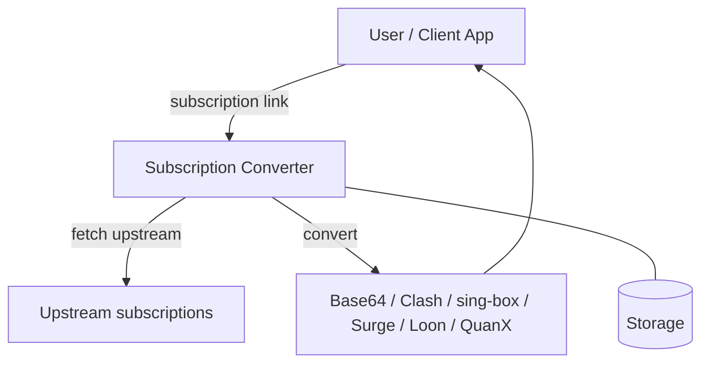
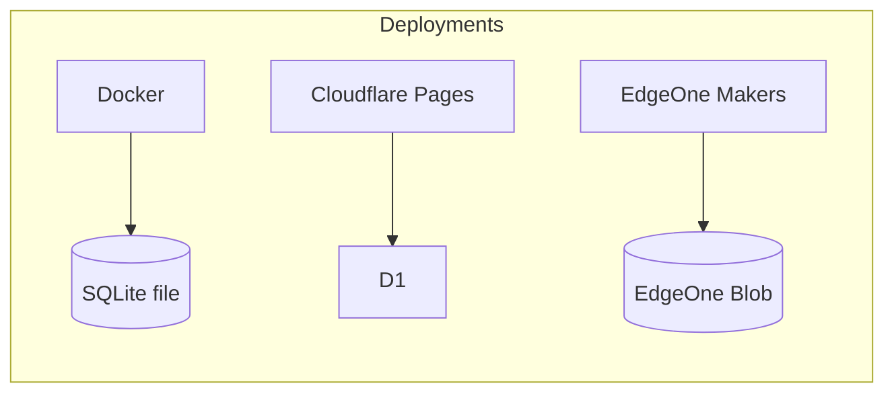
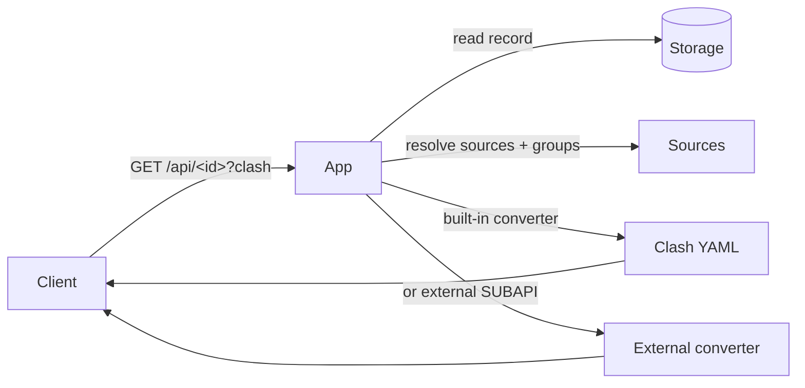

# subconverter-with-web

Subscription converter — a TypeScript + Hono rewrite of [hooleeas/subconverter-new](https://github.com/hooleeas/subconverter-new). Convert proxy subscription links into Base64, Clash, sing-box, Surge, Loon, and Quantumult X formats, with a web admin panel.

[中文](README.zh-CN.md) · [فارسی](README.fa.md)

---

## Architecture



One codebase, three deployments, one storage interface (`Store`):



| Deployment | Storage | Entry point |
|---|---|---|
| Docker | SQLite file (`/app/data/app.db`) | `src/node.ts` |
| Cloudflare Pages | D1 (`subconverter`) | `pages/functions/[[path]].ts` |
| EdgeOne Makers | Blob store (`subconverter`) | `cloud-functions/[[default]].ts` |

> The storage table is auto-created on first use (`CREATE TABLE IF NOT EXISTS kv`). On EdgeOne, Blob has no TTL, so expiry is stored inside each value.

---

## Features

- **All protocols** — VLESS, VMess, Trojan, Shadowsocks, Hysteria2, TUIC, AnyTLS, and more.
- **Six output formats** — Base64, Clash, sing-box, Surge, Loon, Quantumult X.
- **Admin panel** — create, edit, and delete subscription links, groups, SUBAPI backends, and SUBCONFIG rule templates.
- **Two link types**

  | | Visitor link | Self link |
  |---|---|---|
  | Path | `/api/<id>` | `/<id>` |
  | Editable | No — delete and recreate | Yes |
  | Visible to admin | Name only | Full details |

- **Groups** — bundle several sources into a group; a subscription can use groups, direct sources, or both.
- **Link expiry** — set an expiry date/time; expired links are deleted automatically.
- **Import buttons** — one-tap import into 12 clients: sing-box, Shadowrocket, v2rayNG, FlClash, Clash Meta, Clash, Quantumult X, Surge, Loon, Hiddify, Stash, Karing. Buttons are filtered by the visitor's device.
- **Three languages** — Chinese, English, فارسی (RTL). First visit follows the system language.
- **Backup & restore** — export/import all data as JSON; factory reset clears everything.

---

## How a subscription is served



The file name follows the subscription name (`<name>.yaml`, `<name>.json`, `<name>.conf`, `<name>.txt`). Unnamed subscriptions default to `sub-yyyy-mm-dd-HHMM` (Asia/Taipei).

---

## Deploy

### Docker

```sh
docker run -d --name subconverter-web \
  -p 127.0.0.1:25501:25501 \
  -v /opt/subconverter-with-web/data:/app/data \
  --restart unless-stopped \
  hooleeas/subconverter-with-web:latest
```

Or with Compose:

```yaml
services:
  subconverter-web:
    image: hooleeas/subconverter-with-web:latest
    ports:
      - "127.0.0.1:25501:25501"
    volumes:
      - ./data:/app/data
    restart: unless-stopped
```

Image platforms: `linux/amd64`, `linux/arm64`, `linux/arm/v7`.

### Cloudflare Pages

You need a Cloudflare account. No command line needed — everything is done in the [Cloudflare dashboard](https://dash.cloudflare.com).

1. **Create a D1 database.** In the dashboard, go to **Storage & Databases → D1 SQL → Create** and give it any name (for example `subconverter`). Your data lives here; the app creates its tables on first use.
2. **Create the Pages project.** Go to **Workers & Pages → Create → Pages → Connect to Git**, pick this repo, and set:
   - Build command: `npm ci && cp public/admin.html public/admin-page`
   - Build output directory: `public`
3. **Bind the database.** In the project, go to **Settings → Bindings → Add → D1 database**, pick the database you just created, and set the variable name to `DB` — this name is fixed, the app reads its data from `DB`.
4. **Deploy.** Save and Cloudflare starts the first deployment. Your site will be live at `https://<project-name>.pages.dev`, and later pushes deploy automatically.

Open it and start converting — no admin password is set at first, so `/admin` opens directly. Set one in **Site settings** when you want to lock it.

### EdgeOne Makers

You need an EdgeOne account (Tencent Cloud) and Node.js 22+. Storage needs no setup — it is created automatically on first use.

```sh
# 1. Install the CLI (once) and log in (opens a browser to authorize)
npm i -g edgeone
edgeone login

# 2. Deploy from the project root
edgeone makers deploy -n subconverter-with-web
```

Your site will be live at `https://subconverter-with-web.edgeone.cool`. Open it and start converting — no admin password is set at first, so `/admin` opens directly. Set one in **Site settings** when you want to lock it.

Log in first — anonymous deploys create a temporary project and won't keep your data.

---

## Use

1. Open the homepage, pick a SUBAPI and a SUBCONFIG, paste one or more subscription URLs (or node links), and click **Generate**.
2. Copy the link, or tap an import button to open it directly in your client.
3. Open `/admin` to manage links, groups, backends, rule templates, and site settings.

Admin login is optional: if no admin account is set, the panel is open. Set one in **Site settings** to lock it.

---

## API (brief)

| Method & path | What it does |
|---|---|
| `GET /api/health` | Health check → `{"ok":true}` |
| `GET /version` | `subconverter-with-web v0.1.0` |
| `POST /api/subscribe` | Create a visitor link |
| `GET /api/:id` | Serve a visitor link (`?clash`, `?sb`, `?surge`, `?quanx`, `?loon`, `?b64`) |
| `GET /:id` | Serve a self link (same format flags) |
| `POST /api/convert` | Convert posted URLs/nodes to a format |
| `GET /sub?target=<format>&url=<sub>` | Classic subconverter-compatible endpoint |
| `GET /api/public/options` | Backends, rule templates, site title, icon |
| `GET /api/admin/*` | Admin: links, groups, config, data export/import |

---

## Develop

```sh
npm ci
npm run build   # tsc
npm run dev     # local server on :25501 (SQLite)
```

## License

MIT
