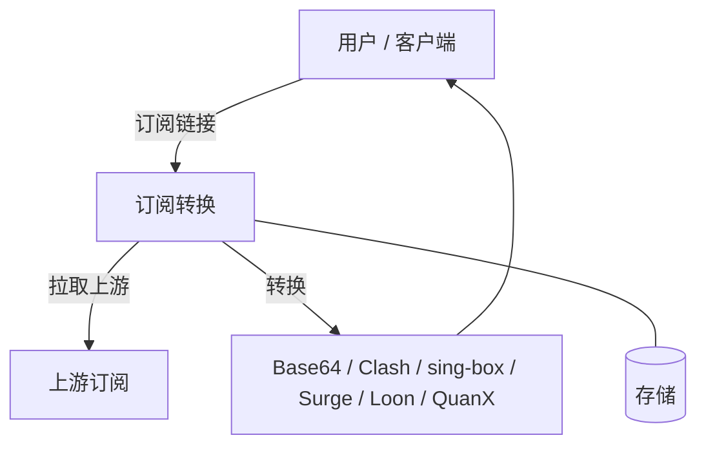
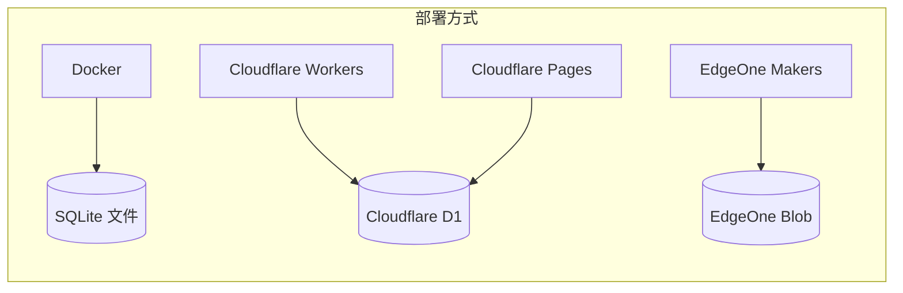
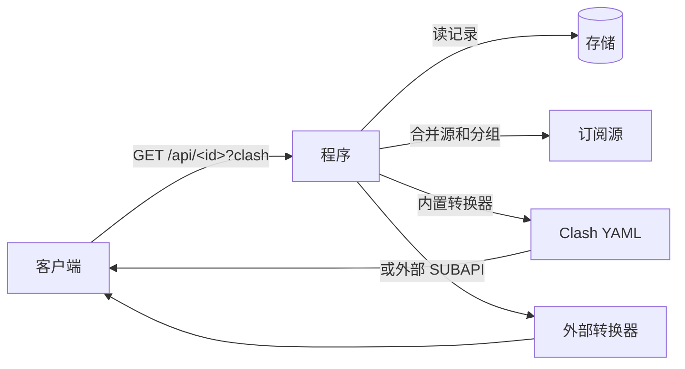

# subconverter-with-web

订阅转换 — C++ subconverter 的 TypeScript + Hono 重写版。把代理订阅链接转换成 Base64、Clash、sing-box、Surge、Loon、Quantumult X 六种格式，带网页管理面板。

[English](README.md) · [فارسی](README.fa.md)

---

## 架构



一套代码，四种部署，同一个存储接口（`Store`）：



| 部署方式 | 存储 | 入口 |
|---|---|---|
| Docker | SQLite 文件（`/app/data/app.db`） | `src/node.ts` |
| Cloudflare Workers | D1（`subconverter`） | `src/index.ts`（`wrangler.toml`） |
| Cloudflare Pages | D1（`subconverter`） | `pages/functions/[[path]].ts` |
| EdgeOne Makers | Blob 存储（`subconverter`） | `cloud-functions/[[default]].ts` |

> 存储表第一次读写时自动建好（`CREATE TABLE IF NOT EXISTS kv`）。EdgeOne 的 Blob 没有过期功能，过期时间存在每条数据里面。

---

## 功能

- **全协议** — VLESS、VMess、Trojan、Shadowsocks、Hysteria2、TUIC、AnyTLS 等。
- **六种输出格式** — Base64、Clash、sing-box、Surge、Loon、Quantumult X。
- **管理面板** — 创建、编辑、删除订阅链接、分组、SUBAPI 后端、SUBCONFIG 规则模板。
- **两种链接**

  | | 访客链接 | 自用链接 |
  |---|---|---|
  | 路径 | `/api/<id>` | `/<id>` |
  | 能不能改 | 不能，删了重建 | 能 |
  | 管理员能看到 | 只有名字 | 全部详情 |

- **分组** — 把多个订阅源打成一个组；订阅可以用分组、直接源，或者两者一起用。
- **链接过期** — 设过期时间，到期自动删除。
- **一键导入** — 12 个客户端一键导入：sing-box、Shadowrocket、v2rayNG、FlClash、Clash Meta、Clash、Quantumult X、Surge、Loon、Hiddify、Stash、Karing。按访问者的设备自动过滤。
- **三种语言** — 中文、English、فارسی（RTL）。首次打开跟系统语言。
- **备份与恢复** — 全部数据导出/导入 JSON；恢复出厂清空所有数据。

---

## 订阅是怎么返回的



文件名跟着订阅名走（`<名字>.yaml`、`<名字>.json`、`<名字>.conf`、`<名字>.txt`）。没填名字的默认 `sub-yyyy-mm-dd-HHMM`（台北时间）。

---

## 部署

### Docker

```sh
docker run -d --name subconverter-web \
  -p 127.0.0.1:3000:3000 \
  -v /opt/subconverter-with-web/data:/app/data \
  --restart unless-stopped \
  hooleeas/subconverter-with-web:latest
```

或用 Compose：

```yaml
services:
  subconverter-web:
    image: hooleeas/subconverter-with-web:latest
    ports:
      - "127.0.0.1:3000:3000"
    volumes:
      - ./data:/app/data
    restart: unless-stopped
```

镜像平台：`linux/amd64`、`linux/arm64`、`linux/arm/v7`。

### Cloudflare Workers

```sh
# 1. 建 D1 数据库
npx wrangler d1 create subconverter

# 2. 把返回的 database_id 填进 wrangler.toml
#    （替换 REPLACE_WITH_D1_DATABASE_ID）

# 3. 部署
npm run deploy:worker
```

### Cloudflare Pages

```sh
# 1. 建 D1 数据库（同上）
npx wrangler d1 create subconverter

# 2. 把返回的 database_id 填进 pages/wrangler.jsonc
#    （替换 REPLACE_WITH_D1_DATABASE_ID）

# 3. 部署
npm run deploy:pages
```

### EdgeOne Makers

```sh
# 1. 装 CLI（一次就行）
npm i -g @edgeone/cli

# 2. 在项目根目录部署
edgeone makers deploy
```

Blob 存储不用配置，`subconverter` 这个库第一次写数据时自动建好。

---

## 使用

1. 打开首页，选 SUBAPI 和 SUBCONFIG，粘贴一个或多个订阅链接（或节点链接），点**生成**。
2. 复制链接，或点导入按钮直接在客户端里打开。
3. 打开 `/admin` 管理链接、分组、后端、规则模板和站点设置。

管理员账号不是必设的：没设账号时管理面板直接能进。在**站点设置**里设了账号密码后才需要登录。

---

## 接口（简表）

| 方法与路径 | 作用 |
|---|---|
| `GET /api/health` | 健康检查 → `{"ok":true}` |
| `GET /version` | `subconverter-with-web v0.1.0` |
| `POST /api/subscribe` | 创建访客链接 |
| `GET /api/:id` | 取访客链接（`?clash`、`?sb`、`?surge`、`?quanx`、`?loon`、`?b64`） |
| `GET /:id` | 取自用链接（同上格式参数） |
| `POST /api/convert` | 把提交的链接/节点转成指定格式 |
| `GET /sub?target=<格式>&url=<订阅>` | 兼容老 subconverter 的接口 |
| `GET /api/public/options` | 后端、规则模板、站点标题、图标 |
| `GET /api/admin/*` | 管理：链接、分组、配置、数据导出/导入 |

---

## 开发

```sh
npm ci
npm run build   # tsc
npm run dev     # 本地跑在 :3000（SQLite）
npx wrangler dev --port 3102   # Workers + 本地 D1 模拟
```

## 协议

MIT
